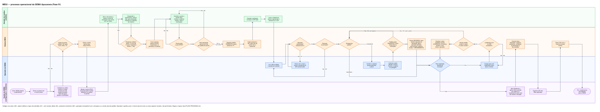

# Fluxo do processo operacional — Fase IV

O processo organiza a entrega de resíduos têxteis em pontos supervisionados pela SEMA Apucarana: o gerador registra o resíduo e recebe um protocolo; o operador confere, pesa e confirma o recebimento; a SEMA acompanha os resultados em relatórios. Participam o gerador do resíduo (cidadão, sem identificação), o operador da SEMA no ponto de coleta, a gestão da SEMA, que configura os pontos e consulta os relatórios, e o sistema MEIU (formulário, painel e API). No sistema, operador e gestão usam o mesmo tipo de conta autenticada; as cores e as raias separam funções, não permissões.

Fluxo conferido com o código da main em 19/11/2026 (`74d425e`).

## Fluxograma

```mermaid
%%{init: {"flowchart": {"wrappingWidth": 320}}}%%
flowchart TD
    %% Gestão da SEMA (configuração e relatórios)
    INI(["Início: SEMA prepara o atendimento"])
    G1["Entrar no painel com e-mail e senha"]
    G2["Cadastrar ou editar o ponto no mapa:<br/>horários por dia, materiais aceitos,<br/>limite de kg por pedido e orientações"]
    G3["Manter o ponto ATIVO enquanto puder receber<br/>(desativar ou reativar no painel)"]
    G4["Abrir Relatórios e aplicar filtros:<br/>período por registro ou recebimento,<br/>ponto, tipo de resíduo e situação"]
    G5["Exportar CSV dos filtros aplicados"]
    FIM(["Fim: recebimentos consolidados para a SEMA"])

    %% Gerador do resíduo (cidadão)
    C1["Abrir o formulário e aceitar o aviso de anonimato<br/>(sem nome, CPF ou CNPJ)"]
    C2["Responder o questionário: mistura, tipo,<br/>peso declarado, frequência e detalhes do material"]
    C3["Escolher o ponto e conferir dias, horários,<br/>materiais aceitos, limite e orientações"]
    C4["Guardar o protocolo ou baixar o QR Code"]
    C5["Levar o material ao ponto e<br/>apresentar o protocolo ou o QR"]

    %% Sistema MEIU
    S1{"Dados do ponto válidos?<br/>fim após início, limite > 0"}
    S2["Salvar o ponto<br/>(ponto novo nasce ATIVO)"]
    S3{"Respostas válidas?<br/>peso > 0 com até 3 casas,<br/>frequência inteira ≥ 1 dia"}
    S4["Listar somente pontos ATIVOS<br/>(localização, se permitida, só ordena)"]
    S5{"Ponto existe<br/>e está ATIVO?"}
    S6{"Peso declarado dentro do<br/>limite por pedido do ponto?"}
    S7["Registrar pedido PENDENTE<br/>e gerar protocolo TX-…"]
    S8["Exibir protocolo e QR Code<br/>(link do painel com o protocolo)"]
    S9{"Operador autenticado?<br/>(sessão de 8 h)"}
    S10{"Protocolo encontrado?"}
    S11{"Situação do pedido?"}
    S12{"Pedido ainda PENDENTE?<br/>(linha bloqueada na transação)"}
    S13["Gravar RECEBIDO: peso aferido separado do declarado,<br/>data e operador definidos pelo servidor,<br/>histórico versão 1 (RECEBIMENTO)"]
    S14{"Justificativa com<br/>5 a 500 caracteres?"}
    S15{"Versão exibida ainda é a atual<br/>e o peso mudou?"}
    S16["Atualizar o peso recebido e gravar CORRECAO<br/>no histórico (anterior, novo, motivo, operador)"]
    S17["Calcular totais separados: registros, pendentes,<br/>recebidos, kg declarados e kg recebidos"]
    S18["Gerar CSV com a mesma consulta da tela"]

    %% Operador da SEMA
    O1["Ler o QR ou digitar o protocolo no painel"]
    O2["Entrar com e-mail e senha<br/>(o protocolo do QR é preservado)"]
    O3["Conferir o material presencialmente e pesar"]
    O4["Informar o peso aferido e marcar<br/>'Conferi o material e a pesagem'"]
    O5{"Peso registrado<br/>precisa de correção?"}
    O6["Corrigir peso com justificativa<br/>(novo peso e motivo)"]

    INI --> G1 --> G2 --> S1
    S1 -->|"Não: 400"| G2
    S1 -->|"Sim"| S2 --> G3 --> C1
    C1 --> C2 --> S3
    S3 -->|"Não"| C2
    S3 -->|"Sim"| S4 --> C3 --> S5
    S5 -->|"Não: 400"| C3
    S5 -->|"Sim"| S6
    S6 -->|"Não: 400"| C3
    S6 -->|"Sim ou sem limite"| S7 --> S8 --> C4 --> C5 --> O1 --> S9
    S9 -->|"Não: 401"| O2 --> S9
    S9 -->|"Sim"| S10
    S10 -->|"Não: 404"| O1
    S10 -->|"Sim"| S11
    S11 -->|"PENDENTE"| O3 --> O4 --> S12
    S12 -->|"Não: 409, sem duplicar"| S11
    S12 -->|"Sim"| S13 --> O5
    S11 -->|"RECEBIDO"| O5
    O5 -->|"Sim"| O6 --> S14
    S14 -->|"Não: 400"| O6
    S14 -->|"Sim"| S15
    S15 -->|"Não: 409, reabrir pedido"| S11
    S15 -->|"Sim"| S16 --> O5
    O5 -->|"Não"| G4 --> S17 --> G5 --> S18 --> FIM

    classDef gestao fill:#f3e8ff,stroke:#7e22ce,color:#111111
    classDef gerador fill:#dcfce7,stroke:#15803d,color:#111111
    classDef sistema fill:#ffedd5,stroke:#c2410c,color:#111111
    classDef operador fill:#dbeafe,stroke:#1d4ed8,color:#111111
    class INI,G1,G2,G3,G4,G5,FIM gestao
    class C1,C2,C3,C4,C5 gerador
    class S1,S2,S3,S4,S5,S6,S7,S8,S9,S10,S11,S12,S13,S14,S15,S16,S17,S18 sistema
    class O1,O2,O3,O4,O5,O6 operador
```

Cores por ator: roxo para a Gestão da SEMA, verde para o Gerador do resíduo, laranja para o Sistema MEIU e azul para o Operador da SEMA. Formas: início e fim arredondados, atividades em retângulo e decisões em losango. Os códigos nas setas são as respostas da API: 400 (dado inválido ou regra não atendida), 401 (sem sessão válida), 404 (protocolo inexistente) e 409 (operação incompatível com a situação ou a versão atual do pedido). O formulário também confere peso, frequência, ponto e limite antes de enviar; a API repete as validações.

### Versão com raias por ator

O mesmo processo, com as mesmas etapas e decisões, em raias horizontais. O arquivo é editável no draw.io; abra a imagem em tamanho original para ler os detalhes.

## Etapas e regras

| Etapa | Responsável | Regra de negócio | Onde está no código |
| --- | --- | --- | --- |
| Entrar no painel | Gestão e operador | Sessão por cookie HttpOnly válida por 8 horas, desde que o operador continue cadastrado. Todas as rotas administrativas exigem login. Não há senha padrão nem cadastro de operadores pelo painel: as contas são criadas com `npm run admin:create`. Login limitado a 15 tentativas por IP em 15 minutos. | `POST /auth/login`, `GET /auth/me` em `MEIU_API/src/modules/auth/`; guarda global em `auth.module.ts`; limites em `src/config/request-protection.ts`; script `MEIU_API/scripts/create-admin.cjs`; tela `site-frontend/src/pages/Login/`. |
| Configurar ponto | Gestão | Horários por dia com fim posterior ao início, no mesmo dia; até 50 materiais; limite por pedido opcional, maior que zero e com até três casas; orientações. Ponto novo é criado ATIVO. | `POST` e `PUT /pontos-coleta` em `pontos-coleta.service.ts` e `dto/create-ponto-coleta.dto.ts`; tela `site-frontend/src/pages/CadastroPontoColeta/`. |
| Desativar ou reativar ponto | Gestão | Ponto INATIVO deixa de aparecer no formulário e recusa novos pedidos; pedidos já registrados continuam disponíveis para recebimento. Excluir ponto com pedidos retorna 409. | `DELETE /pontos-coleta/:id?tipo=soft\|reativar\|hard` em `pontos-coleta.controller.ts` e `pontos-coleta.service.ts`. |
| Responder questionário | Gerador | Aviso de anonimato antes do formulário. Peso declarado positivo, com até três casas; frequência inteira de pelo menos um dia; detalhes preenchidos ou "Não sei informar". | `mobile-frontend/src/pages/Aviso/Aviso.tsx`; `QuestionarioColeta/hooks/useQuestionarioColeta.ts`; `MEIU_API/src/modules/descartes/dto/create-descarte.dto.ts`. |
| Escolher ponto | Gerador e sistema | Somente pontos ativos são listados. A localização é opcional, só ordena por proximidade e não é enviada no pedido. Condições do ponto são exibidas antes do envio. | `GET /pontos-coleta` em `pontos-coleta.controller.ts`; `usePontosColeta.ts`, `useLocalizacaoAtual.ts`, `StepMapaColeta.tsx` e `CondicoesAtendimento.tsx`. |
| Registrar pedido | Sistema | Sem aprovação prévia. Ponto inexistente ou inativo e peso declarado acima do limite retornam 400. Pedido nasce PENDENTE, com protocolo `TX-` e 16 caracteres hexadecimais. Horários não bloqueiam o registro antecipado. Até 30 registros por IP em 15 minutos. | `POST /descartes`, método `create()` em `descartes.service.ts`; limite por IP em `request-protection.ts`. |
| Guardar protocolo/QR | Gerador | QR gerado no navegador com o link do painel e o protocolo; não carrega dados do material. A consulta pelo QR exige login. | `mobile-frontend/src/pages/QuestionarioColeta/components/TelaSucesso.tsx`. |
| Localizar pedido | Operador | Busca exata pelo protocolo, sem diferenciar maiúsculas; protocolo inexistente retorna 404. O painel mantém o protocolo do QR durante o login e abre o pedido depois. | `GET /descartes/protocolo/:protocolo`, `findByProtocol()` em `recebimentos.service.ts`; `site-frontend/src/App.tsx` e `pages/PedidosColeta/PedidosColeta.tsx`. |
| Conferir e pesar | Operador | A conferência é presencial. Peso aferido positivo, com até três casas, e marcação "Conferi o material e a pesagem" obrigatórias. O sistema não tem situação de recusa. | `salvar()` em `PedidosColeta.tsx`; `RecebimentoDto` em `dto/recebimento.dto.ts`. |
| Confirmar recebimento | Sistema | Transação com bloqueio do pedido: só PENDENTE pode ser recebido; confirmação concorrente ou repetida retorna 409 sem duplicar. Pedido antigo sem ponto vinculado também retorna 409. Peso aferido fica separado do declarado; data e operador vêm do servidor; histórico registra a versão 1. | `POST /descartes/:id/recebimento`, `receive()` em `recebimentos.service.ts`; tabela `recebimento_historico` na migração `1793232002000-receipts.ts`. |
| Corrigir peso | Operador e sistema | Só para pedido RECEBIDO. Motivo de 5 a 500 caracteres (400). A versão exibida precisa ser a atual e o novo peso, diferente do atual (409). Grava CORRECAO com peso anterior, peso novo, motivo e operador; preserva o declarado e o recebimento original. | `PATCH /descartes/:id/recebimento`, `correct()` em `recebimentos.service.ts`; `CorrigirRecebimentoDto` em `dto/recebimento.dto.ts`. |
| Consultar relatório | Gestão | Período por data de registro ou de recebimento, inclusivo, em America/Sao_Paulo; início anterior ou igual ao fim. Kg recebidos somam só pedidos RECEBIDO; somas em gramas inteiras; eventos de histórico não contam como novas entregas. | `GET /relatorios`, `consultar()` em `relatorios.service.ts` e `filtro-relatorio.dto.ts`; tela `site-frontend/src/pages/Relatorios/Relatorios.tsx`. |
| Exportar CSV | Gestão | Usa a mesma consulta da tela. O botão fica desabilitado se os filtros forem alterados sem aplicar. UTF-8 com BOM, ponto e vírgula, vírgula decimal e proteção contra fórmulas. | `GET /relatorios/csv`, `csv()` em `relatorios.service.ts`; `exportar()` em `Relatorios.tsx`. |

## Limitações

- O formulário não exige nome, CPF ou CNPJ. O sistema não identifica quem gerou o resíduo.
- Registros representam pedidos, não pessoas únicas. Um mesmo gerador pode registrar vários pedidos.
- O recebimento confirma a entrega no ponto; não comprova a destinação posterior do material.
- O fluxo foi validado em testes controlados. O piloto real com a SEMA fica pendente para a próxima fase.
- Horários orientam a entrega; não são agendamento. O limite vale por pedido, não por pessoa ou por dia.
- Não existe situação de recusa: se o material não for aceito no ponto, o pedido permanece PENDENTE.
- Operador e gestão usam o mesmo tipo de conta; não há permissões por ponto.
